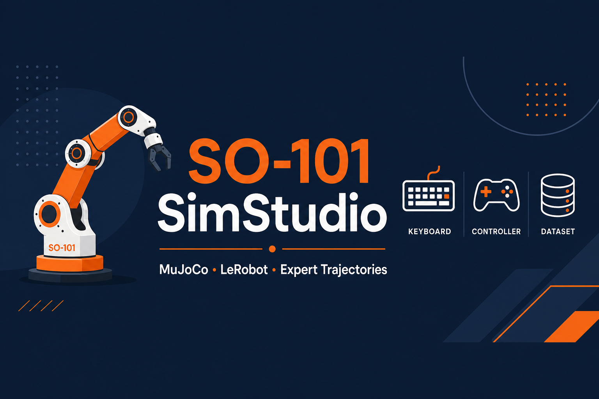
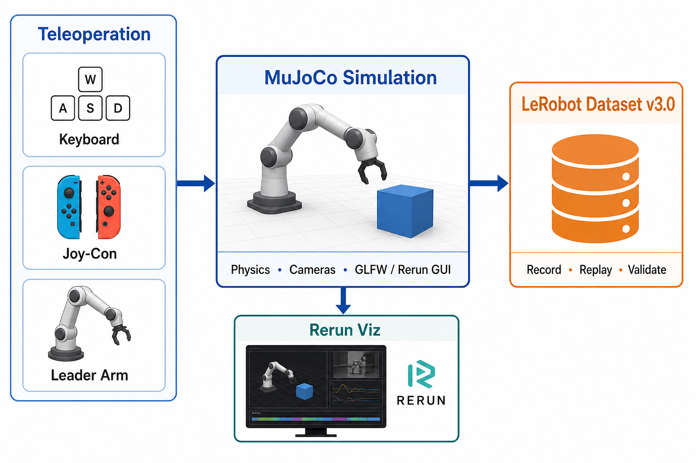

<p align="center">
  
</p>

# SO-101 SimStudio

SO-101 simulation studio for expert trajectory generation with MuJoCo and LeRobot.

## Overview

<p align="center">
  
</p>

SO-101 SimStudio is a MuJoCo-based teleoperation platform for collecting expert demonstration datasets for behavior cloning. v0.1.4 adds a closed-loop Lab 01 line on the same table pick: agent-generated demonstrations, policy finetunes, and one frozen eval.

**Core capabilities:**
- Multiple teleop backends (keyboard, Joy-Con, leader arm)
- Two recording GUIs: **MuJoCo** (GLFW 3D window) and **Rerun** (multi-camera stream)
- High-fidelity MuJoCo physics simulation
- LeRobot v3.0 dataset format
- Lab 01 pick-and-place: record or agent-collect → train → MuJoCo eval
- Modular, extensible architecture

**Platform focus:** Validated on **Ubuntu 24.04 + AMD ROCm** only. **NVIDIA CUDA (Linux)** and **macOS (Apple Silicon / MPS)** are **not supported** in this release — unverified, no install path; see [ROADMAP](ROADMAP.md).

## Features

### Recording GUI (`--view_mode`)

Both modes record the same LeRobot v3.0 dataset; only the live preview differs.

| GUI | Config flag | Status | Notes |
|-----|-------------|--------|-------|
| **MuJoCo** | `--view_mode mujoco` (default) | ✅ | Native GLFW 3D simulation window; interactive camera |
| **Rerun** | `--view_mode rerun` | ✅ | LeRobot Rerun viewer; multi-camera stream; useful on Wayland / headless-friendly workflows |

Post-recording visualization: `dataset_viz` (Rerun) and replay scripts.

### Teleoperation

| Method | Status | Notes |
|--------|--------|-------|
| Keyboard | ✅ | World-frame velocity (WASD + keys) |
| Joy-Con | ✅ | Cylindrical reach/swing, left or right |
| Leader arm | ✅ | Feetech STS3215, 1:1 position mapping |

### Dataset pipeline

| Feature | Status | Notes |
|---------|--------|-------|
| Record | ✅ | Multi-episode, resume |
| Replay | ✅ | Single or all episodes |
| Validate | ✅ | Quality checks |
| Visualize | ✅ | Rerun (`dataset_viz`) + replay |

### Simulation

- **Robot**: SO-101 6-DOF arm
- **Scene**: Table pick task (`simple_pick`)
- **Cameras**: front / top / wrist
- **Physics**: MuJoCo

### Lab 01 pick-and-place (v0.1.4)

Same scene and success rule as the leader-teleop lab. Two data sources, one eval.

| Piece | What it is |
|-------|------------|
| Human reference | 50 leader episodes, still the v0.1.3 Hub set |
| Agent set | **193 episodes / 130,835 frames**. Scripted grasps cover an XY grid and yaw bins, with the wrist following the cube. 53 of the episodes are successful follow rollouts from an ACT policy trained on the first 140 |
| Finetunes | Camera choice, 6-D absolute joints vs relative actions, and frozen / LoRA / full updates. Gains are per model; a full update is not always better |
| **Home20** | 20 frozen cube poses, arm home, gripper start 0.85, seeds 1000 / 1001 / 1002. Quote `final_success` as /20 and /60 |

Adopted Home20 totals on that protocol: ACT 6-D **53/60** (first 140 episodes only), SmolVLA **51/60**, MolmoAct2 LoRA **39/60**, pi05 full unfreeze **34/60**, DM0.5 **25/60**, GR00T N1.7 absolute **14/60** (uploaded frozen checkpoint; the unfrozen run is 15/60 and was not uploaded). The only score table is [Home20](labs/lab01_pnp_agent/home20.md). The LeRobot submodule stays at v0.6.0; the DM0.5 checkpoint is not loadable from that pin.

## Requirements

### Supported platform (current release)

| Environment | Status |
|-------------|--------|
| **Ubuntu 24.04 + AMD ROCm 7.x** | ✅ **Supported** — tested and documented (`make rocm-sync`) |
| **NVIDIA CUDA (Linux)** | ❌ **Not supported** — unverified; planned |
| **macOS (incl. Apple Silicon / MPS)** | ❌ **Not supported** — unverified; planned |

SimStudio ships a **single supported install path:** `make rocm-sync` → `.venv-rocm` with ROCm PyTorch.

**Do not** use `uv sync` — it installs CUDA PyTorch and is not supported. CUDA and macOS support will be added in a future release once validated; see [ROADMAP](ROADMAP.md).

CPU-only runs are possible for headless CI (`render_window: false`) but are not the target workflow; GPU teleoperation and VLA training require ROCm.

### Tested environment

- **OS**: Ubuntu 24.04
- **GPU**: AMD ROCm 7.2.x
- **Python**: 3.12+
- **RAM**: 8 GB+
- **Storage**: 10 GB+

### Dependencies

- MuJoCo 3.x
- PyTorch 2.x (**ROCm** backend on AMD — installed via `make rocm-sync`)
- LeRobot (git submodule, pinned to v0.6.0)

## Layout

```
so101-simstudio/
├── src/simstudio/           # Core package
│   ├── robots/              # Robot implementations
│   ├── teleoperators/       # Keyboard, Joy-Con, leader
│   ├── scripts/             # record, replay, teleoperate, …
│   └── common/              # Shared utilities
├── configs/                 # YAML configs
├── SO101/                   # MuJoCo assets
├── labs/                    # Lab 01 teleop + agent-yaw / Home20
├── scripts/smoke/           # Parameterized manual smoke tests
├── scripts/quicktest/       # Fixed 2-episode collaboration runs
├── lerobot/                 # LeRobot submodule
└── third_party/             # joycon-robotics, etc.
```

## Quick start

See [QUICKSTART.md](QUICKSTART.md).

```bash
git clone --recursive https://github.com/rocPAI-Forge/so101-simstudio.git
cd so101-simstudio
make rocm-sync
source .venv-rocm/bin/activate

# Verify ROCm PyTorch (HIP must not be None; version should contain +rocm)
python -c "import torch; print(torch.__version__, torch.version.hip, torch.cuda.is_available())"

# Joy-Con users: also run `make joycon-sync` (see QUICKSTART Install)

.venv-rocm/bin/python -m simstudio.scripts.record \
    --config configs/so101_mujoco_keyboard.yaml \
    --view_mode mujoco   # or rerun
```

**Manual tests:**

```bash
make smoke-keyboard-record VIEW_MODE=mujoco EPISODES=1
make smoke-joycon-record SIDE=right VIEW_MODE=mujoco
./scripts/quicktest/keyboard.cmd    # fixed 2-episode run → test.log
```

## Status

| Component | Status |
|-----------|--------|
| MuJoCo sim robot | ✅ |
| Keyboard teleop | ✅ |
| Joy-Con teleop (cylindrical + one-handed recording) | ✅ |
| Leader arm teleop | ✅ |
| Record / replay / validate | ✅ |
| MuJoCo recording GUI (`view_mode=mujoco`) | ✅ |
| Rerun recording GUI (`view_mode=rerun`) | ✅ |
| Lab 01 ACT / SmolVLA train + MuJoCo eval | ✅ |
| Agent-yaw 193-episode dataset + Home20 eval | ✅ |
| Lab 01 MolmoAct2 / pi05 / GR00T / DM0.5 finetunes | ✅ |
| Real follower hardware | 🔲 Planned |

## Version history

- **v0.1.4** (`release-v0.1.4`): 193-episode agent dataset (scripted poses + ACT follow); per-model camera, joint-frame, and full-finetune trials; Home20 as the only cross-model score; MolmoAct2, pi05, GR00T N1.7, DM0.5
- **v0.1.3** (`release-v0.1.3`): Lab 01 pick-and-place (record → ACT/SmolVLA train → sim2sim eval); lab-local eval configs; Hub reference dataset/policies; wrist cam + spawn layout; ROCm-only docs
- **v0.1.2** (`release-v0.1.2`): Joy-Con cylindrical reach/swing; decoupled HID sticks; gripper toggle; one-handed A/Y/+ recording; `scripts/quicktest/`; joycon-robotics upstream pin + install-time patch; English docs/prints; repo `so101-simstudio`
- **v0.1.1** (`release-v0.1.1`): Unified `--view_mode mujoco/rerun`; evdev recording controls; leader reliability; `reset_arm` / `reset_cube`; smoke scripts in `scripts/smoke/`
- **v0.1.0** (`release-v0.1.0`): First stable release; keyboard, Joy-Con, leader
- **v0.0.2** (`release-v0.0.2`): Leader arm support
- **v0.0.1** (`release-v0.0.1`): Initial release

## Documentation

- [Quick start](QUICKSTART.md)
- [Lab 01 — PnP record / train / eval](labs/lab01_pnp/lab01_pnp.md)
- [Lab 01 agent data](labs/lab01_pnp_agent/lab01_pnp_agent.md) · [Home20 scores](labs/lab01_pnp_agent/home20.md)
- [Architecture](DESIGN.md)
- [Roadmap](ROADMAP.md)
- [Agent / dev guide](AGENTS.md)
- [Acknowledgements](ACKNOWLEDGEMENTS.md) · [Third-party licenses](THIRD_PARTY_NOTICES.md) · [Simulation asset attribution](SO101/ATTRIBUTION.md)

## Acknowledgements

This project stands on open-source work from [LeRobot](https://github.com/huggingface/lerobot),
[MuJoCo](https://github.com/google-deepmind/mujoco), [The Robot Studio SO-ARM100](https://github.com/TheRobotStudio/SO-ARM100),
[box2ai joycon-robotics](https://github.com/box2ai-robotics/joycon-robotics), [Rerun](https://github.com/rerun-io/rerun),
and many other libraries. See [ACKNOWLEDGEMENTS.md](ACKNOWLEDGEMENTS.md) for the full list.

## License

**SO-101 SimStudio** (original code in this repository) is licensed under
[Apache-2.0](LICENSE).

This project depends on and bundles third-party software and robot assets under
their own licenses (LeRobot, MuJoCo, joycon-robotics, SO-ARM100 lineage, Python
dependencies, etc.). Those components are **not** relicensed under Apache-2.0.

| Document | Purpose |
|----------|---------|
| [LICENSE](LICENSE) | Apache-2.0 terms for project-authored code |
| [NOTICE](NOTICE) | Apache `NOTICE` file for distributions |
| [THIRD_PARTY_NOTICES.md](THIRD_PARTY_NOTICES.md) | Submodules, dependencies, compatibility notes |
| [SO101/ATTRIBUTION.md](SO101/ATTRIBUTION.md) | MuJoCo / URDF / mesh provenance |

When redistributing releases, include `LICENSE`, `NOTICE`, and
`THIRD_PARTY_NOTICES.md` (and submodule license files if you ship submodules).
