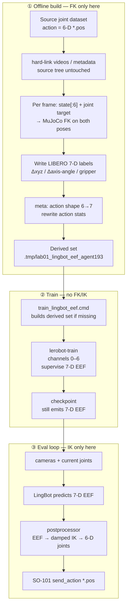

# LingBot-VA EEF adaptation for SO-101

Status: experimental. This is the fair replacement for the historical
stuffed-joint recipe; do not quote a Home20 score until training and closed-loop
evaluation complete.

## Why an adapter is required

`lerobot/lingbot_va_libero_long` predicts the LIBERO controller action:

```text
[dx, dy, dz, d_axis_angle_x, d_axis_angle_y, d_axis_angle_z, gripper]
```

The controller clips the first six channels to `[-1, 1]`, scales translation
by 0.05 m and rotation by 0.5 rad, applies the rotation in the world frame, and
uses positive gripper commands to close. These are Cartesian increments, not
absolute SO-101 joints.

The old Lab 01 recipe put six absolute joints directly in channels 0–5. That
changed the action language and was never a fair LingBot-VA transfer.

## Project-level implementation

The pinned `lerobot/` submodule stays unmodified.

- `build_lingbot_eef_dataset.py` hard-links the 193-episode dataset into local
  scratch and rewrites only action parquet/statistics.
- `SO101EEFAdapter` computes MuJoCo FK labels and damped least-squares IK.
- `train_lingbot_eef.cmd` trains with channels 0–6 and front+wrist cameras.
- `rollout_lingbot_eef.yaml` plus `LAB01_LINGBOT_EEF_ADAPTER=true` converts
  unnormalized LingBot commands back to six safe absolute joints.

SO-101 has five arm joints, so it cannot realize every arbitrary 6-DoF pose
increment. IK projects model output onto the reachable five-joint manifold and
enforces MuJoCo joint limits. Expert-derived targets are on that manifold.

## Pipeline (FK offline → train → IK online)

**FK runs only when building the derived dataset. Training does not call FK/IK.
IK runs only at closed-loop eval** (`LAB01_LINGBOT_EEF_ADAPTER=true`).



Per-frame FK label (build script):

```text
q_t = observation.state[:6]     # current joints
q*  = action                   # expert absolute joint target
(p_t, R_t) = FK(q_t)
(p*, R*)   = FK(q*)
action_eef = [ (p*-p_t)/0.05m , rotvec(R* R_tᵀ)/0.5rad , gripper_sign ]
```

Eval inverts that: predicted `action_eef` → scaled pose increment → damped LS
IK → six absolute joints for SO-101.

## Reuse

**Process:** yes — this is the reusable pattern for any policy whose official
action language is **LIBERO-style Cartesian EEF Δ + gripper** (LingBot-VA base /
libero_long / robotwin, and similar OSC-style heads). Keep
`SO101EEFAdapter` + `build_lingbot_eef_dataset.py` + eval IK postprocessor;
swap only the policy checkpoint and train recipe.

**Derived 193 EEF dataset:** yes for another train that expects the **same**
contract (7-D LIBERO scales/frames/gripper sign, front+wrist rename map). Rebuild
only if the source joint demos change or the EEF convention changes. Do **not**
feed it to joint-space policies (ACT, MolmoAct2 6-D, GR00T joint pad, etc.) —
those keep the original 6-D joint Hub set.

Local cache: `.tmp/lab01_lingbot_eef_agent193`. Hub:
[`alexhegit/so101-simstudio-lab01-pnp-agent193-lingbot-eef`](https://huggingface.co/datasets/alexhegit/so101-simstudio-lab01-pnp-agent193-lingbot-eef)
(`LAB01_LINGBOT_EEF_DATASET_REPO_ID`). Push after rebuild:
`./labs/lab01_pnp/push_lingbot_eef_dataset.cmd`.

## Dataset gate

Source:
`alexhegit/so101-simstudio-lab01-pnp-agent-yaw-v4-actonly-follow2`
(193 episodes / 130,835 frames).

Derived Hub id:
`alexhegit/so101-simstudio-lab01-pnp-agent193-lingbot-eef`
(local build root: `.tmp/lab01_lingbot_eef_agent193`).

```bash
.venv-rocm/bin/python labs/lab01_pnp/build_lingbot_eef_dataset.py \
  --source datasets/so101-simstudio-lab01-pnp-agent-yaw-v4-actonly-follow2 \
  --output .tmp/lab01_lingbot_eef_agent193

.venv-rocm/bin/python -m simstudio.scripts.validate_dataset \
  --root .tmp/lab01_lingbot_eef_agent193

LAB01_HF_UPLOAD_ENDPOINT=https://huggingface.co \
  ./labs/lab01_pnp/push_lingbot_eef_dataset.cmd
```

Measured conversion:

- arm-channel clipping fractions:
  `[0.000573, 0.000023, 0.017029, 0, 0, 0]`;
- 1,000-frame deterministic FK/IK audit: 979 commands inside controller
  bounds, 21 clipped;
- on those 979, position error mean 0.058 mm, p95 0.177 mm;
- orientation error mean 0.00081 rad, p95 0.00120 rad.

The 45 solver calls that did not meet the strict internal convergence flag
still contribute to the error totals above; the maximum audit pose errors were
1.55 mm and 0.034 rad.

## Training and evaluation

ROCm note: set `MIOPEN_FIND_MODE=2` (Fast Find) on first MI210 runs. Default
MIOpen Find can spend tens of minutes enumerating convolution kernels before the
first training step; PyTorch ROCm calls MIOpen automatically for GPU convs.

Short smoke (GPU, PEFT LoRA, batch 1):

```bash
export MIOPEN_FIND_MODE=2 HIP_VISIBLE_DEVICES=0
LAB01_LINGBOT_OUTPUT=/tmp/lab01_lingbot_eef_smoke \
LAB01_LINGBOT_STEPS=2 LAB01_LINGBOT_SAVE_FREQ=1 \
LAB01_LINGBOT_BATCH_SIZE=1 LAB01_LINGBOT_NUM_WORKERS=0 \
  ./labs/lab01_pnp/train_lingbot_eef.cmd \
  --policy.wan_pretrained_path=/tmp/lingbot-va-base
```

Overnight PEFT run (local scratch, not published):

| Item | Value |
|------|--------|
| Output | `/tmp/lab01_lingbot_eef_agent193` |
| Steps | 500 → resume to **10 000** (bs=1, save every 1000) |
| Learnable / total | ~42 M LoRA / ~5 B |
| Train loss | ~3.1 → ~0.66 @500; ~0.25–0.33 mid-run @6K |
| VRAM | ~16.2 GB (MI210) |
| Steady step time | ~1.2 s/step after MIOpen warmup |

Closed-loop (fixed demo cube `(0.27, 0.20, −8°)`, arm `home`, OSMesa, sync):

```bash
LAB01_LINGBOT_EEF_ADAPTER=true \
LAB01_POLICY_PATH=/tmp/lab01_lingbot_eef_agent193/checkpoints/010000/pretrained_model \
LAB01_EVAL_CONFIG=labs/lab01_pnp/configs/rollout_lingbot_eef.yaml \
LAB01_EVAL_EPISODES=1 LAB01_MUJOCO_GL=osmesa LAB01_RENDER_WINDOW=false \
  ./labs/lab01_pnp/eval.cmd \
  --robot.reset_cube=fixed \
  --robot.cube_positions_path=labs/lab01_pnp/configs/cube_positions_demo_fixed.json \
  --eval.episode_time_s=35
```

| Checkpoint | n | Success | Funnel (1 ep) | Notes |
|------------|---|---------|---------------|-------|
| 000500 | 1 | **0/1** | `reach_8cm=1`, `near_4cm=0`, close=0 | Arm entered 8 cm; cube shifted slightly |
| 005000 | 1 | **0/1** | `reach_8cm=0` … all zeros | Cube unmoved; `min_gripper_cube≈0.15 m` |
| 010000 | 1 | **0/1** | `reach_8cm=0` … all zeros | Same |

### Overnight resume + Lab01-PnP-Home20 (2026-10-17 → 10-18)

Resume PEFT train **10 000 → 25 000** (`/tmp/lab01_lingbot_eef_agent193`, MI210).
Derived dataset published:
[`alexhegit/so101-simstudio-lab01-pnp-agent193-lingbot-eef`](https://huggingface.co/datasets/alexhegit/so101-simstudio-lab01-pnp-agent193-lingbot-eef).

**Home20 on ckpt 010000** (EEF adapter, `home`, gripper 0.85, OSMesa, seeds 1000/1001/1002):

| Seed | final_success | reach_8cm | near_4cm | close_after_open |
|------|---------------|-----------|----------|------------------|
| 1000 | **0/20** | 5/20 | 1/20 | 0/20 |
| 1001 | **0/20** | 5/20 | 2/20 | 0/20 |
| 1002 | **0/20** | 9/20 | 3/20 | 2/20 |
| **Total** | **0/60** | 19/60 | 6/60 | 2/60 |

Logs: `outputs/eval/lingbot_va_eef_home20_seed{1000,1001,1002}.log`.
IK often non-converged (~1195–1198/1200 ticks/ep); ~1.9 Hz infer.
**Not a ranking score** — record as fair-adapter negative transfer with occasional reach.

Home20 on **025000** seeded separately (`lingbot_va_eef25k_home20_seed1000.log`); fill when complete.

**Verdict for issue #9:** fair EEF path trains/evals end-to-end; **0/60** Home20 at 10K. Do not treat as classroom policy.
