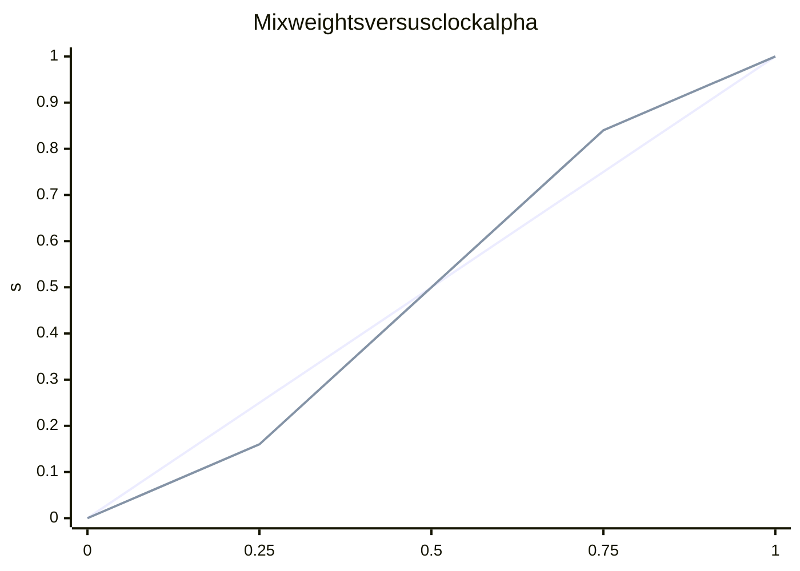
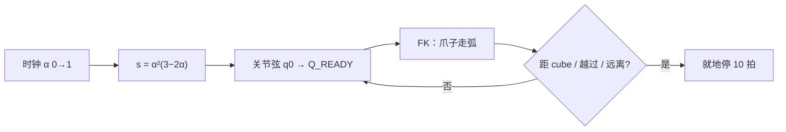

# Lab 01 — 用 Agent 改进数据、训练与闭环成功率

日期：2026-09-20  
来源：外部备忘 `so101_simstudio_agent_data_improvement.md`。  
本页是 **Lab 01 落地实验记录**：按阶段写清 **Agent 做什么**、底层算法是什么、评测怎么对上。

**本章主张：** 闭环成功率首先卡在示范质量与覆盖，而不是再叠一个 20 Hz 大模型伺服。Agent 用在 **编程、相位设计、按观感改采集器、以后按失败分箱加采**；真正写入数据集、给 ACT 学的，是仿真里确定性的关节轨迹。

| 阶段 | 目标 | Agent 的作用 | 状态 |
|------|------|----------------|------|
| 0 审计 | 量化人工 50 集的差 | 写审计脚本、读漏斗、定「干净轨迹」标准 | 已完成 |
| **1 脚本化抓放 + 可录** | 能稳定抓放并写成 LeRobot v3 | **人在环编程**：定相位/特权信息/IK 与插值分工；看 GLFW 改过冲与推块 | **已完成（100 成功集）**；ACT 80K 闭环 **9/50（18%）** — 见 [`agent_act_80k.md`](agent_act_80k.md) |
| **1b yaw→腕部** | 按立方体面法向 standoff + `wrist_roll`，分箱采成功集并 **重训** 新 ACT | 规格见 [`agent_act_80k.md`](agent_act_80k.md) §7；**不**混固定腕 100 条；不从 080000 resume | **采集 100 条**（配额满）；覆盖见 [`data_vs_success.md`](data_vs_success.md)；50 条 ACT 已清；**100 条 ACT 80K 从零训练中** |
| 2 分箱采集 + ACT mix | 用 **转腕后** 的 auto 数据抬高 ACT；teleop 配比另开 | 扩采样、quality 过滤、配比实验、对照表 | 未做（勿把旧 100 条与 teleop 原样混合） |
| 3 失败 mining | 补现行策略不会的 bin | Agent 只出宏参数 / 加采配方，不进控制环 | 未做 |
| 4 真机感知 | 去掉仿真特权 pose | 另开；不阻塞仿真数据工厂 | 推迟 |

运行时采集循环里 **没有** LLM 逐步出动作。编码在 Cursor Agent 中完成（本阶段实现为 IDE 里的编程 Agent，不是策略 checkpoint）。

---

## 和现有评测对得上的诊断

§6.4 已经不是「完全没有成功样本」：

| 策略 | 全范围 | 主要死法 |
|------|--------|----------|
| ACT 6-D / 15-D | 58% / 64% | 最好，仍有漏抓 |
| MolmoAct2 6-D | 54% | 漏抓为主 |
| SmolVLA | 22% | 多数不离 spawn |
| GR00T 10K | 0/10 | 能接近（reach 9–10/10），**不闭合/不抬升** |

备忘里的四条（轨迹不干脆、覆盖不足、分布窄、成功≠高质量）和漏斗一致。Hz bench 说明 GR00T/SmolVLA 的失败 **不是** 20 Hz 断档，而是数据/接触阶段。

### Phase 0 快扫（本机 50 集 `datasets/so101-simstudio-lab01-pnp`）

20 Hz，21218 帧：

| 量 | 值 | 读法 |
|----|----|------|
| 时长 | 中位 20.3 s，最长 52.9 s | 不少停顿/修正 |
| EE 路径长 | 中位 1.50 m，p90 1.84 m，最长 3.43 m | 工作区只有 ~8 cm × 7 cm；干净抓放应远短于 1.5 m |
| 夹爪闭合边沿 | 均值 2.3 次/集，最多 4 | 反复开合，不是一次干脆夹 |
| 起始 EE | 标准差 ~1 cm | leader `follow`，起始姿态不算散 |

**缺口（录制当时）：** `reset_cube: random`，cube XY/yaw **没有写进 LeRobot parquet**。后来用俯视首帧反推了三套数据的朝向（精度见 [`data_vs_success.md`](data_vs_success.md)）；新采集仍应把 spawn 写进 sidecar，不要依赖事后估计。

`validate_dataset.py` 只查完整性/关节限，**不打质量分、不查覆盖**。

Agent 在 Phase 0 的产出：把「看起来乱」变成可对比的代理指标，并规定 Phase 1 生成器必须补 spawn 元数据。

---

## 采纳 / 推迟

| 备忘建议 | Lab 01 决定 | Agent 边界 |
|----------|-------------|------------|
| Agent 不做 20–50 Hz 伺服 | **采纳**。宏参数 → MuJoCo Jacobian / `send_action` 闭环 | Agent 改代码与增益，不进控制环 |
| keyframe + 小步纠偏 scripted grasp | **Phase 1 主路径** | Agent 设计相位与停条件 |
| 成功只是门槛 + quality 分 | **采纳**。clean / hard / junk 分组混训 | Phase 2 |
| x/y/yaw 分箱 + 低成功率加采 | **采纳**。评测仍用 full-range | Phase 2–3 |
| 保留人工 teleop 作种子 | **采纳**。10–25% 配比，不删 Hub 50 集 | mix 时 Agent 只定配比实验 |
| 对照：lab01 / auto / mix / quality / mining | **采纳**。第一枪 post-train 仍走 **ACT 6-D** | Phase 2 |
| 顶视 RGB-D、heightmap 当 policy 输入 | **推迟到真机** | 生成器可用特权 pose；**不得**写进策略输入 |
| LLM 分类失败视频 | Phase 3。入库仍以确定性 verifier 为准 | Agent 分类是辅助 |
| `lerobot-train` 200K Diffusion | 先复用 `train_act.cmd` 量级 | — |

---

## Phase 1 — Agent 如何产出高质量抓取轨迹

实现：[`auto_collect_poc.py`](../lab01_pnp/auto_collect_poc.py)、[`auto_collect_poc.cmd`](../lab01_pnp/auto_collect_poc.cmd)。  
场景：`SO101/scenes/simple_pick`，机器人 `action_mode=position`（6 维关节，与 ACT 对齐）。

### 1. 这一阶段 Agent 具体做了什么

人给出目标（干净抓放、少推块、少过冲、能录 LeRobot）。**Cursor Agent 编程**完成采集器，并按 GLFW / 无头日志迭代。运行时 **不是**「每拍问大模型下一步拧哪」。

| 层 | 谁 | 做什么 |
|----|----|--------|
| 实验设计 | 人 + Agent | 不用 20 Hz LLM 伺服；特权 cube pose 只给生成器 |
| 相位与几何 | Agent 写代码，人看窗口 | `Q_READY` 盆地、减速停、蠕动容差、闭爪冻结手臂 |
| 控制律 | 代码（确定性） | 关节插值 + 阻尼最小二乘雅可比 IK |
| 质量门槛 | 代码 + 人的观感约束 | `check_pick_success`；失败默认不入库 |
| 记录 | Agent 接 LeRobot | 成功 episode → v3 parquet/视频 + `spawns.jsonl` |

**高质量在本阶段的含义（还不是 Phase 2 的分箱覆盖）：**

- 一次接近、一次闭合，不反复开合（对照人工集均值 2.3 次闭合边沿）
- 末端走「曲肘低位靠近 → 软包络 → 抬升 → 放盒」，而不是高举再 3 关节 IK 下不去
- 固定颚不犁方块；接近不冲过 cube 再折返
- 动作是关节位置，策略将来能直接模仿

### 2. 特权信息：仿真里的 cube 位姿

每集 `reset` 后 `SO101MujocoRobot.get_block_position()` 读 MuJoCo `block` 关节 `qpos` 的 xyz。抓取笛卡尔目标为 `[cx, cy, GRASP_Z]`（`GRASP_Z = 0.012`）。盒子用固定 `CONTAINER_XY`。

这是 **scripted 生成器的特权**。相机图像仍写入数据集，供策略学；**策略输入不得包含 cube 真值**。真机阶段必须换感知，本阶段故意用特权，才能先把接触几何做干净。

### 3. 相位流水线

```text
reset → 读 cube
  → ready：沿 Q_READY 关节路径、按到 cube 的距离减速并就地停
  → 腕关节钉到 WRIST_GRASP
  → creep：雅可比 IK 把 gripperframe 推到 grasp xyz（软容差）
  → 手臂冻结，夹爪插值闭合 + hold
  → lift / to-box / lower：IK 到盒上方再放下
  → 张开、retreat
  → check_pick_success → 成功则 save_episode
```

**不要**「先抬到高 pre-grasp 再下降」：teleop 曲肘 `Q_READY` 已在抓取高度（`gripperframe.z ≈ 0.006`）。3 关节位置 IK 从高处回不到这个盆地。

### 4. 关节空间插值（ready）

`Q_READY ≈ [0.40, 0.99, −1.11, 1.56, 0.17]` 来自人工遥操作「曲肘、已在抓取高度」，是 **目标关节**，不是先指定 xyz 再离线 IK。

每拍对五个臂关节做：

\[
q = (1-s)\, q_0 + s\, q_{\text{goal}},\quad
s = \alpha^2(3-2\alpha),\quad \alpha \in [0,1]
\]

`s` 是 smoothstep：缓起缓停。夹爪开合同一套。

#### 怎么看（双空间）

同一时刻看两张图：左边是关节，右边是爪子。平面 2 关节示意与代码同一套混合公式，不是 SO-101 五轴 CAD。

```text
关节空间（两个角当坐标）              工作空间（爪子 xyz）
                                  爪子轨迹 = 弧（会擦过 / 越过 cube）
  elbow ↑                           ● Q_READY 若插满
        |     Q_READY               :  .
        |       ●                   :    cube
        |      /  ← 直线弦          :  /
        |  ●brake  距 cube 够近停    ●──●──●  当前臂
        |  /
        | ● q0                      基座
        +--------→ shoulder
```

| 记号 | 在哪 | 含义 |
|------|------|------|
| `q0` → `Q_READY` 直线 | 关节空间 | 五个角同步按同一比例混合；弦上的位置由 **s** 决定，不是由时钟 α 直接决定 |
| 橙色当前点 | 关节空间 | 代码真实 pose：\(q=(1-s)q_0+s q_{\text{goal}}\) |
| 空心点（线性时钟） | 两空间 | 若 \(s=\alpha\)：起步更猛、末端更硬 |
| 蓝色虚线 | 工作空间 | 把关节弦 **走满** 时，爪子扫过的弧 |
| `brake` | 关节弦上的提前终点 | 爪子到 cube 水平距 ≲ 3.6 cm（或越过 +X / 近处开始远离）就冻结当前关节，不插到 100% `Q_READY` |

时钟 α 匀速从 0 到 1；真正用来混合关节的是 s。两端 s 涨得慢（缓起缓停），中间接近匀速：



上条折线是 \(s=\alpha\)（线性），下条是 \(s=\alpha^2(3-2\alpha)\)（smoothstep；α = 0.25 / 0.75 处约为 0.16 / 0.84）。



**读法一句话：** 插值从不规划爪子直线；它只在角度弦上往前走。距离刹车避免把这条弧走到 cube 远侧。

关节直线 **不是** 爪子直线。完整插到 `Q_READY` 会从 cube 旁甩到远侧。因此 `goto_ready_without_passing_cube` 仍沿这条关节路径，但：

- 水平距离 ≥ 10 cm：全速推进 \(\alpha\)
- 进入 10 cm：二次曲线把步进缩到约 0.1×
- 距 cube ≲ 3.6 cm，或已越过 cube +X，或近处开始远离：冻结当前关节 10 拍（就地停，不 snap 回更早的 `q`）

Agent 在这里的贡献：把「插满 keyframe」改成 **带距离刹车的关节路径**，消除过冲再走回的假动作。

### 5. 阻尼最小二乘雅可比 IK（creep / lift / place）

`servo_xyz` **在线闭环**，不是一次性解整条 `q(t)`。

每拍：`mj_forward` → 读 `gripperframe` 的 `site_xpos` → 笛卡尔误差 × `kp`，近目标缩小、并 cap 步长 → `mj_jacSite` 取 3×n 位置雅可比 →

\[
\Delta q = J^\top (J J^\top + \lambda I)^{-1} \Delta x
\]

（`LAM = 1e-3`），限幅后写成 `*.pos` 经 `_send_q` → `send_action`。

接近 cube 时 `lock_wrist=True`，只用肩/肘 3 列，腕钉在 `WRIST_GRASP`。可选：试走一步若 XY 误差翻到目标 **远侧** 则撤回（挡「IK 一步跨过」）。蠕动用更小 `kp` / `dq_lim` / `max_step` 和 `XY_TOL_CREEP = 6 mm`，避免固定颚犁块。闭合后抬升解开腕锁定。

Agent 在这里的贡献：把键盘 teleop 的速度 IK 换成 **抓取专用的限步、防穿、低增益蠕动**；接触阶段不再追着 cube 中心打磨。

### 6. 写入数据集（Agent 接记录层）

`--record` / `LAB01_POC_RECORD=1`：`ScriptedRecorder` 在每拍 `_send_q` 上挂钩。

- 观测/动作经 `hw_to_dataset_features` + `build_dataset_frame`，与 Lab 01 相机 + 关节契约一致
- **LeRobot 必须先于 mujoco 导入**，否则 OSMesa + torch 可能 SIGSEGV
- `LeRobotDataset.create` 使用 `mkdir(..., exist_ok=False)`：无 `meta/info.json` 的根目录整树删掉再建；有则 resume
- 成功或 `--save-failures` 才 `save_episode`；否则 `clear_episode_buffer`
- `spawns.jsonl`：每集 `episode / success / frames / spawn`（补 Phase 0 元数据缺口）

无头冒烟（2026-09-20）：1 集成功，**473 帧**，v3 + 三路视频，根目录示例 `.tmp/lab01_scripted_poc_smoke`。

### 7. 入口

```bash
# 质量审计（parquet，不含 cube 覆盖）
.venv-rocm/bin/python labs/lab01_pnp/audit_teleop_quality.py

# .43 可视化（DISPLAY + GLFW）
./labs/lab01_pnp/auto_collect_poc.cmd

# 录制成功集（默认根 .tmp/lab01_scripted_poc）
LAB01_POC_RECORD=1 LAB01_POC_EPISODES=5 ./labs/lab01_pnp/auto_collect_poc.cmd

# 无头录制
LAB01_POC_RECORD=1 LAB01_POC_HEADLESS=1 MUJOCO_GL=osmesa \
  LAB01_POC_EPISODES=10 ./labs/lab01_pnp/auto_collect_poc.cmd
```

覆盖：`LAB01_POC_DATASET_ROOT`、`LAB01_POC_REPO_ID`、`LAB01_POC_RANDOM=1`、`LAB01_POC_SAVE_FAILURES=1`。

原始评测 Hz / RTC 口径仍见 [`hz_bench/COMPARISON.md`](../lab01_pnp/hz_bench/COMPARISON.md)。

### 8. Phase 1 已证明 / 尚未证明

**已证明：** 脚本专家能写成 LeRobot v3；ACT 能把它学到很低 BC loss（80K，loss 0.013）。

**已证伪（当前专家）：** 仅 XY 随机 + 固定 `WRIST_GRASP` 的 100 成功集 **不能** 接近 teleop ACT 的 64%。正式 GLFW 评测 **9/50（18%）**。闭合时 100/100 集 `wrist_roll=0.17`，且成功过滤把 `+30…+45°` 削成 0 集。图 + 成功率对照：[`data_vs_success.md`](data_vs_success.md)；80K 复盘：[`agent_act_80k.md`](agent_act_80k.md)。

**尚未证明：**

- 按 cube **yaw 转腕** 的新专家集能否抬高闭环
- x/y/yaw **分箱覆盖**（Sobol / 低成功率加采）
- 与人工 50 集的配比（且不得把固定腕角 100 条当默认 mix）
- 真机：无特权 cube pose

---

## 后续阶段（Agent 角色预告）

2. **scripted collector 扩量** — Agent 把固定 spawn 换成分箱；quality filter；目标先 200 smoke，再 500–2000。  
3. **ACT 6-D mix** — Agent 跑对照（lab01 / auto / mix），用 full-range eval 看漏斗，不靠缩小随机盒刷分。  
4. **failure mining** — Agent 读策略失败 bin，只输出加采宏参数，控制律仍是本页的插值 + IK。
