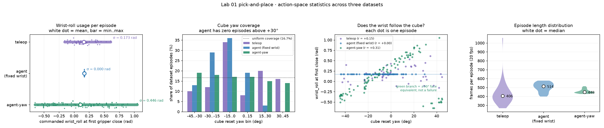

# Lab 01 — 三种示范数据 vs ACT 闭环成功率

Date: 2026-09-22  
Related: [agent_act_80k.md](agent_act_80k.md)（固定腕 80K 复盘）、[data_improvement.md](data_improvement.md)（阶段账）、[lab01_pnp.md](../lab01_pnp/lab01_pnp.md) §6.4。

本页把两张覆盖图、三种 LeRobot v3 示范、以及已经做过的 ACT 闭环数字放在同一张对照里。核心读法：**示范里立方体朝向是否多样、腕部是否跟着朝向变，决定了 ACT 在全范围随机 yaw 上能不能抬起来**；训练集越大、BC loss 越低，并不能补偿这个缺口。

图由 [`estimate_cube_pose.py`](../lab01_pnp/estimate_cube_pose.py)（俯视相机反推 reset 位姿）+ [`dataset_stats_viz.py`](../lab01_pnp/dataset_stats_viz.py) 生成，输出在 [`viz/`](viz/)。三列保持为 teleop 50、固定腕 100、agent-yaw 100。v4 的 DAgger 和后来的 ACT follow 不画进这张图，读法在 [`lab01_pnp_agent.md`](lab01_pnp_agent.md)。

---

## 1. 两张图怎么读


左起：home 位姿（三角形顶角 = 基座 → 初始夹爪方向，实测为 **+Y**）；接着三套数据集各一格。每个小方块按该集 reset **yaw** 旋转，颜色同色条（蓝负 / 红正）。

- **Teleop**：红蓝都有，朝向覆盖接近采集时声明的 ±45°。
- **Agent（固定腕）**：几乎全是蓝到浅蓝。位置铺满 8×7 cm 盒子，**朝向却挤在负角一侧**。
- **Agent-yaw**：**100 条**，红蓝交错；XY 四格和六个 yaw 区间都按配额填满（远/低 Y 比 50 条时密）。



四联读法：

1. **腕部 roll（闭合瞬间）** — 固定腕塌成一点；teleop 有人的补偿带宽；agent-yaw 跨度最大。
2. **Yaw 占数据集比例** — 固定腕在 `+30…+45°` 是 **0%**；teleop / agent-yaw 接近均匀线。
3. **腕是否跟着立方体转** — 固定腕是水平线（r = 0）；agent-yaw 有斜率（r = +0.31，大角度会切到 ±90° 等价面，所以不是 1.0）；teleop 介于中间（r = +0.15）。
4. **时长** — 脚本轨迹更齐；teleop 中位更短但尾巴更长（修正、停顿）。

Teleop / 固定腕采集时 **没有把 cube yaw 写入 parquet**。图中朝向是俯视首帧反推值：相对 agent-yaw 真值（n=100），yaw 误差 **+0.13 ± 1.56°**，位置 σ ≈ 0.8 mm。引用时按估计值，不要当日志真值。

---

## 2. 三种数据对照

同一任务、同一随机盒子（`x∈[0.26,0.34]`，`y∈[0.165,0.235]`，**yaw ±45°**），示范来源不同。

| | Teleop（leader） | Agent 固定腕 | Agent-yaw |
|---|---|---|---|
| Hub / 本地 | `so101-simstudio-lab01-pnp` | `…-pnp-agent` | `…-pnp-agent-yaw` |
| 采集器 | 人手 leader | [`auto_collect_poc.py`](../lab01_pnp/auto_collect_poc.py)，腕锁死 | [`auto_collect_yaw.py`](../lab01_pnp/auto_collect_yaw.py)，面法向 + 转腕 |
| 保存成功集 | 50 | 100 | **100** |
| 帧数（20 Hz） | 21 218 | 50 126 | 45 654 |
| 中位时长 | 406 帧 ≈ 20 s | 514 帧 ≈ 26 s | 448 帧 ≈ 22 s |
| 闭合 `wrist_roll` | +0.161 ± 0.173 rad | **+0.170 ± 0.000 rad** | +0.104 ± 0.446 rad |
| Cube yaw（反推 / 日志） | +2.6 ± 23.4°（−42.5…+44.7） | **−11.7 ± 15.0°（−43.9…+29.5）** | −3.0 ± 26.9°（−44.6…+44.8） |
| `\|yaw\|>30°` 占比 | 26% | **13%** | 33% |
| `+30…+45°` 成功集 | 8/50 | **0/100** | 17/100（日志配额；俯视反推 14/100，边界误差） |
| 采集成功率 | 人手全保留 | sidecar 109/233 ≈ 47%，Hub 再筛到 100 | 初次 50/68 ≈ 74%；扩到 100 合计 100/299 ≈ 33%（`far_low_y` 难格拉低） |
| 示范里 yaw→腕 | 弱相关（人会转，但不严谨） | **无** | **有**（最近面） |

固定腕那一列的关键不是「100 条比 50 条少」——条数更多、轨迹更干净——而是 **成功过滤器把难角度扔掉了**。专家在 ±45° 盒子里采样，但只有固定 0.17 rad 还能夹起来的姿态进了 Hub。像素里仍能看到一点旋转；动作在闭合点完全不变。

---

## 3. IL 实践结果（ACT，同一评测盒子）

评测 YAML：`labs/lab01_pnp/configs/rollout_act.yaml`，`reset_cube=random`（含 yaw ±45°），`reset_arm=follow`，sync，`n_action_steps=50`。

| 示范 | 训练 | BC loss | 闭环 | 漏斗要点 |
|---|---|---|---|---|
| Teleop 50 | ACT 15-D，50K，bs64 | ~0.053 | **32/50（64%）** | 全范围参考；Hub `…-pnp-act` |
| Agent 固定腕 100 | ACT 15-D，80K，bs64 | **0.013** | **9/50（18%）** | reach 50/50 → close 47/50 → **lift 14/50** → 9/50。GLFW 30 s / 600 ticks。[`agent_act_80k.md`](agent_act_80k.md) |
| Agent-yaw **100** | ACT 15-D，80K，bs64，目录 `lab01_pnp_act_agent_yaw`（50 条中途 ~32K 已停并删 ckpt，**从零重训**） | 训练中（`num_episodes=100`，`num_frames=45654`） | **尚无 n=50** | 不得用固定腕 080000 或混入固定腕 100 条来代替这份评测 |

不要引用固定腕在 DORobot OSMesa 上的 **0/50**：那是墙钟 60 s + ~2 Hz 渲染，模拟时间只有约 6 s。

同一套 ACT、同一随机盒子：示范从「人会转腕、朝向较满」换成「腕锁死、朝向被成功过滤」之后，成功率从 64% 掉到 18%。多一倍数据、更低 loss、更齐的轨迹，没有抬升闭环。

---

## 4. 数据和成功率怎么连在一起

评测时立方体仍按 **±45°** 抽。固定腕 ACT 几乎没在训练里见过「正向大角度 + 对应转腕」的标签：

```
eval yaw box          teleop demos           fixed-wrist demos         yaw-aware demos
[-45°, +45°]     →    覆盖较满、腕会动   →   成功集约 [-44°, +30°]     →   六档配额填满
                                          腕恒为 0.17
                                          难角度在采集阶段被丢掉
```

漏斗把这个缺口钉在 **接触阶段**，不是导航：50/50 都摸到 8 cm 内，47/50 夹爪闭合，只有 14/50 抬起 2 cm。闭合而不抬，就是夹爪轴线和立方体面没对齐、打滑。图 1 中间那片蓝色和图 2 的水平腕部线，是同一件事的空间版和动作版。

因果链（按证据强度）：

1. **专家不用 yaw** → 闭合动作恒定（parquet 上 σ = 0，不是估计）。
2. **难角度采集失败被丢** → Hub 100 条的朝向分布被拧歪（图 1 中栏 + 图 2 分箱；`+30…+45°` 为零）。
3. **ACT 克隆这份专家** → loss 0.013，接近 50/50，抬升 14/50。
4. **评测仍抽满 ±45°** → 18%，低于 teleop 64%。

次要、尚未单独消融：`reset_arm=home` 录制 vs `follow` 评测、抓取高度、中心点 creep。它们解释不了「闭合 σ=0 却评测全范围 yaw」。Place 也不是瓶颈（抬起来的 14 集里 9 集放进盒子）。

Teleop 为什么还能到 64%：人手会为朝向改腕部（图 2 左栏有带宽），朝向也没有被成功过滤器削掉。相关只有 r = +0.15，说明人不是几何上最优的面对齐，但 **动作会随可见 yaw 变**，够 ACT 学到一个能用的抓取族。

---

## 5. 现在卡在哪

XY 已按配额补到 100 条（各格 25）。50 条上的 ACT 已停、权重已删；DORobot 上同一目录 `lab01_pnp_act_agent_yaw` 正对 100 条 **从零** 跑 80K / bs64。配方见 [`collect_yaw.cmd`](../lab01_pnp/collect_yaw.cmd) 和 [`agent_act_80k.md`](agent_act_80k.md) §7.6。

在那之前不要：

- 把固定腕 100 条和 teleop 或 agent-yaw **原样混合**（两套抓取教师互相打）；
- 从 `lab01_pnp_act_agent/080000` resume；
- 用 BC loss 或条数论证「脚本数据已经更好」。

重画覆盖图：

```bash
.venv-rocm/bin/python labs/lab01_pnp/estimate_cube_pose.py --report
.venv-rocm/bin/python labs/lab01_pnp/dataset_stats_viz.py
```
