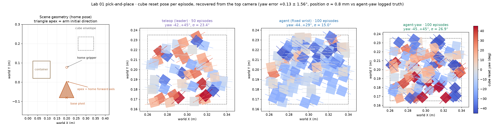
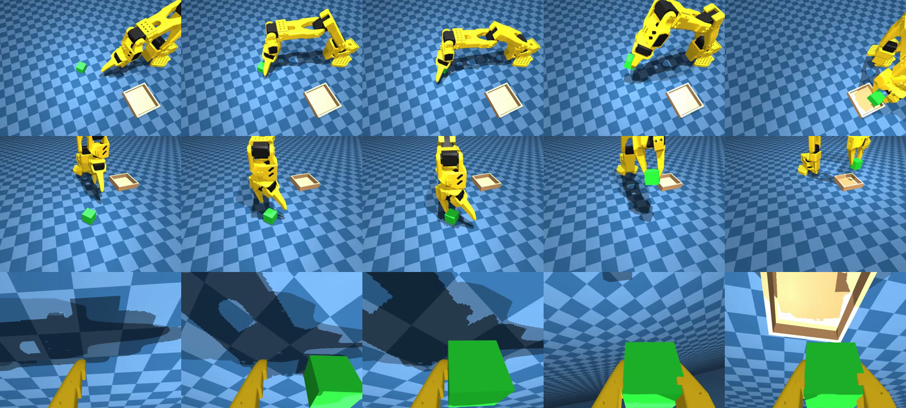
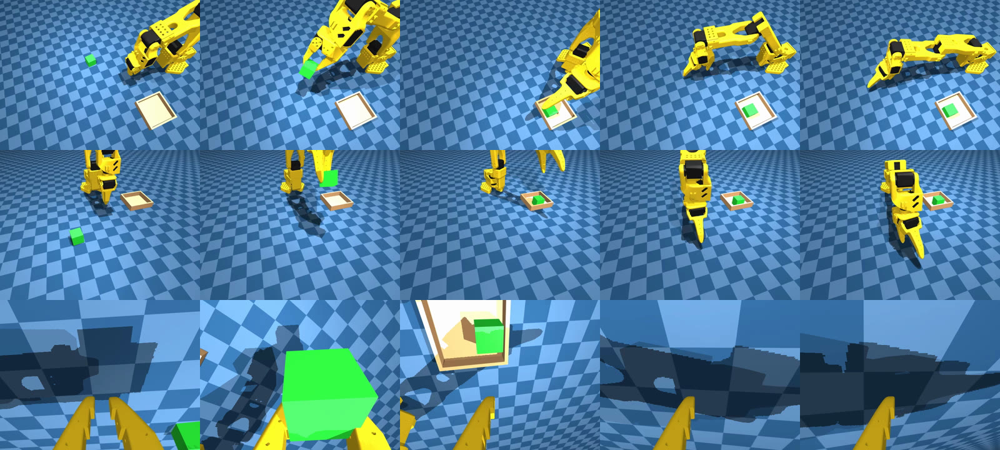

# Lab 01 PnP Agent — 用 Agent 生成专家轨迹

日期：2026-10-14  
任务、场景和评测都和 [Lab 01 PnP](../lab01_pnp/lab01_pnp.md) 相同。区别在专家轨迹的来源：Lab 01 由人操作 leader 臂录 teleop，本 lab 由 Agent 编写的采集器和已训好的策略自动产生轨迹。

本页分两块。前半是数据怎么生成：为什么改用 Agent、哪些改法没有提高 SmolVLA、193 条里有什么。Home20 的协议、成绩、各模型为什么停、基座和微调的下载链接都在 [`home20.md`](home20.md)。逐次实验的数字在链接的账本里，本页只规定怎么读这些数字。

命名：目录是 `labs/lab01_pnp_agent/`，数据和模型这一代叫 **agent-yaw**，当前是 **agent-yaw v4**。Hub 上的 `alexhegit/so101-simstudio-lab01-pnp-agent` 已经被固定腕的 100 条脚本集占用，对应 ACT 15 维全范围 **9/50**。新的数据和权重不要复用这个 Hub id，继续用 `…-agent-yaw-*`。

## 目录

| 路径 | 内容 |
|---|---|
| `lab01_pnp_agent.md` | 本页：实践总结和目录 |
| [`data_improvement.md`](data_improvement.md) | 分阶段记录：teleop 质量审计 → 脚本抓放 → 按朝向转腕 |
| [`agent_act_80k.md`](agent_act_80k.md) | 固定腕 100 条 + ACT 80K（**9/50**）复盘，以及 agent-yaw 采集规格 |
| [`data_vs_success.md`](data_vs_success.md) | teleop / 固定腕 / agent-yaw 三套数据的覆盖图和 ACT 闭环成功率 |
| [`smolvla_v4_diversity.md`](smolvla_v4_diversity.md) | agent-yaw v4 上 SmolVLA 从 **0/50** 到 Home20 **51/60** 的每一步 |
| `hf_dataset_card_agent*.md` | 固定腕、agent-yaw v1–v4 数据集的 Hub 卡片 |
| [`home20.md`](home20.md) | Home20 协议、唯一的成绩表、各模型为什么停、基座和微调的下载链接、发布脚本 |
| `_env.sh` | `source` Lab 01 的 `_env.sh`，再设 Home20 清单和 193 条 Hub id |
| `configs/smolvla_v4_div50_home20_spawns.json` | Home20 的 20 个方块位姿。`labs/lab01_pnp/configs/` 里的同名文件是符号链接 |
| `configs/rollout_act_agent_yaw.yaml` | agent-yaw ACT 评测：`gripperframe`，夹爪 0.85，`reset_arm: home` |
| `push_*.cmd` | 193 / agent-yaw 的模型和数据集上传。`labs/lab01_pnp/` 里的同名脚本会转到这里 |
| `hf_model_card_act_agent_yaw_v4.md` | ACT 6 维 agent-yaw v4 的 Hub 卡片（由 `push_act_agent_yaw_v4_model.cmd` 上传） |
| `hf_model_card_smolvla_follow2.md` | SmolVLA follow2 2.5K 的 Hub 卡片 |
| `hf_model_card_molmoact2_agent193.md` | MolmoAct2 加长 20K 的 Hub 卡片 |
| `hf_model_card_pi05_agent193.md` | pi05 10K（Home20 **12/60**）的 Hub 卡片 |
| `hf_model_card_pi05_agent193_unfreeze.md` | pi05 全量解冻（Home20 **34/60**）的 Hub 卡片 |
| `hf_dataset_card_agent_yaw_v4_follow2.md` | 193 条 follow2 数据集的 Hub 卡片 |
| `hf_model_card_groot_agent193_abs.md` | GR00T N1.7 绝对关节 10K 的 Hub 卡片 |
| `viz/` | 覆盖图。`coverage_topview.png` 固定为 teleop 50 / 固定腕 100 / agent-yaw 100，不换入 v4 |
| `media/` | 演示 mp4 和关键帧截图，由 `make_demo_media.py` 从数据集导出 |
| `datasets/` | 指向仓库根 `datasets/` 下各 agent 数据集的软链接，不进 git |

采集器仍在 [`../lab01_pnp/`](../lab01_pnp/)：`auto_collect_poc.py`、`auto_collect_yaw.py`、`collect_yaw.cmd`、`collect_policy_recovery.py`、`collect_policy_takeover.py`、`train_upweight_episodes.py`、`probe_*.py`。训练和评测入口也在那里：`train_*.cmd`、`eval.cmd`。本目录的 `_env.sh` 先加载那份模板，再只覆盖 Home20 和 193 条的变量。Home20 清单和 `rollout_act_agent_yaw.yaml` 在本目录 `configs/`。

## 协议先分开

下面这些数不能写成一次考试：

| 列 | 什么不变 | 现在用来引用的数 |
|---|---|---|
| Teleop 全范围 | 50 条人手 leader，方块在记录盒里新抽，ACT 用 `follow`，SmolVLA 用 `home` | ACT 15 维 **32/50**，ACT 6 维 **29/50**，SmolVLA **11/50** |
| 固定腕 Agent 全范围 | 100 条，腕锁死，ACT `follow` | ACT 15 维 **9/50** |
| agent-yaw v4 SmolVLA 全范围 | 140 条脚本成功，`home`，另一次随机 | **0/50** |
| **Lab01-PnP-Home20** | 同一 20 个方块点，手臂 `home`，夹爪起点 **0.85**，种子 1000 / 1001 / 1002 各测一次 | 成绩表只在 [`home20.md`](home20.md) |

Home20 的 60 次是 20 个点测 3 次，不是 60 个新点，也不叫 Home60。种子只改变策略采样动作块时的噪声序列，不改变方块、手臂或权重。这不是域随机化。夹爪 **−0.1** 的旧分数暂时留着，不写进 0.85 这一列。follow2 这份权重还没有新的全范围 50 集，不能把 **51/60** 说成全范围成功率。

## 为什么用 Agent 生成数据

### 人操作的成本

Teleop 每条都要人用 leader 臂在仿真里抓放。条数上不去，时长和中途停顿因人而异。脚本轨迹更齐：teleop 中位约 20 秒且尾巴更长，agent-yaw 中位约 22 秒但没有同样的人工修正停顿（见 [data_vs_success.md](data_vs_success.md)）。这是改用 Agent 的操作理由。

「人看屏幕」和「仿真相机里的画面」不一致、所以人手轨迹不平滑，是采集时的经验，不是已经单独量化过的失败原因。已经量过的失败原因写在下一节。

### 三列出生点图：teleop、固定腕、agent-yaw 100

这张图保留原样，不把 v4 换进去，也不另画 DAgger。左起是场景，然后三套数据各一列。小方块的朝向和颜色都是该集的 reset yaw（蓝负、红正）。数字和读法在 [`data_vs_success.md`](data_vs_success.md)。



评测盒子是 `x∈[0.26,0.34]`、`y∈[0.165,0.235]`、yaw ±45°。

- Teleop 50 条的朝向接近这个 ±45°，正向大角度有 8/50。位置只有 50 个人手点。
- 固定腕 100 条把位置铺开了，但成功过滤把正向大角度丢掉（`+30…+45°` 为 **0/100**），闭合时 `wrist_roll` 几乎是常数。ACT 15 维从 teleop 的 **32/50** 掉到 **9/50**。漏斗停在抬起：接近 50/50，闭合 47/50，抬起只有 14/50。
- Agent-yaw 100 条按 XY 格子和 yaw 区间配额采集，腕跟着立方体朝向转。这一列补回的是朝向和转腕，不是另一套任务。

所以不能写成「teleop 的立方体角度分布不够广，Agent 因此全面解决了多样化」。Teleop 的角度覆盖本身接近评测盒子。Agent 先因为腕锁死把角度多样性弄丢，再由 agent-yaw 加回来。

### agent-yaw 100 条评测暴露的问题

朝向补回来之后，失败从「夹爪不跟方块转」变成「闭合了但抬不起来」。

在这 100 条上从零训练的 v1 ACT 15 维 80K，home、`n_action_steps=50`、n=20、末端用 `gripperframe`、夹爪起点 0.85：闭合 **20/20**，抬起 **7/20**，成功 **7/20**。抬起之后没有掉落。同一权重在末端站点配错时只有成功 3/20；3/20 不作为这列的成绩。这次没有留下全范围 n=50，不能写成和 teleop **32/50** 同一张表上的数字。日志 `outputs/eval/act_yaw_80k_home_gripperframe_n20.log`。

v2 针对这个失败加了重抓和空抓恢复，但录的是专家接手之后的片段，模型自己走错的前半段没有进标签。v2 上从零训的 40K 仍是成功 **7/20**（抬起 8/20），没有续到 80K。

### 为何有 v4，以及 DAgger 的 20 条

**DAgger**（Dataset Aggregation）是模仿学习里补「模型自己会走到的状态」的做法。纯专家轨迹只覆盖专家走过的路。模型一旦偏出去，数据集里没有从那个状态回来的动作。做法是让当前模型自己跑，跑到它真正会停住的地方，再请专家从那里接手，把两段写成一条轨迹，加进数据集再训。

v4 在 v3 的 120 条后面加上这种整段 DAgger 20 条，合成 140 条。采集是 `collect_policy_recovery.py --mode full`，当时的策略是 agent-yaw v3 ACT 80K：

1. 从 home、夹爪 0.85 出发，方块仍在同一个随机盒子里。
2. 模型自己控制，每一帧都录下来。
3. 只留下「夹爪已经闭合、方块仍没有抬起 2 cm、并且连续保持 40 拍」。模型自己抬起来的、超时的都丢掉。
4. 脚本专家从「闭合但方块还在桌上」接手，重新抓起并放进盒子。前后两段是同一条轨迹。

这 20 条和那 120 条的差别在轨迹中间，不在出生点。方块仍从同一个盒子里抽，所以再画一张 reset 分布图看不出 DAgger。要看的是前缀：120 条从头到尾都是专家；这 20 条的前缀是模型的失误，后缀才是专家纠正。

这 20 条没有单独把 SmolVLA 抬起来。把含它们在内的 140 条拿去训 SmolVLA，全范围仍是 **0/50**；同一 20 个点上再训 3000 步仍是 **0/20**，而且一次都不闭合。肩、肘、`wrist_flex` 在这些成功轨迹里仍然很窄。SmolVLA 会模仿这条窄管，闭环一旦偏出去，夹爪保持张开。

### 193 条里实际有哪几类

当前 SmolVLA 用的 `agent-yaw-v4-actonly-follow2` 是 **193 条 / 130835 帧**。它不是把试过的增量全部叠进去，只保留下面 6 类。集号是这条数据集里的 `episode_index`。

| 集号 | 条数 | 轨迹是什么 | 为什么加 |
|---|---:|---|---|
| 0–99 | 100 | 脚本专家从 home 一次抓成。腕按接近面转正，两爪都接触才闭合，然后抬起放下 | v3 的主集。v1 的 100 条把朝向补回来了，但这 100 条是抓取修正之后重采的，不是 v1 那 100 条原样拷贝 |
| 100–109 | 10 | 脚本专家，夹爪还张开时先做一次小幅对准，再一次抓成。整段仍是 home 到放下 | 对准 v1 里「还没闭合就偏了」的情况。偏移动作不单独当失败标签 |
| 110–119 | 10 | 脚本专家，半张（+0.50）的局部没夹住不写入标签；原地张开再抓第二次，不先抬高退回 | 对准「夹空了再抓」。一条里有两次抓取 |
| 120–139 | 20 | **DAgger**。v3 ACT 80K 从 home 自己推理，录到「闭合但没抬起」；脚本专家从该状态接手直到放下。一条里前段是模型、后段是专家 | v2 只存专家接手后的尾巴，成功仍是 7/20。这里把模型真正走到的失败前缀也存下来 |
| 140–170 | 31 | **ACT follow**。用「只在前 140 条上训好的 v4 ACT 6 维 50K」在 `reset_arm: follow` 下自己跑完，只留成功。每条 1200 帧，没有专家接手 | 同一 140 条训出的 SmolVLA 全范围 **0/50**、固定点 **0/20** 且不闭合。这份 ACT 在 Home20 上是 **53/60**。用它自己走通的轨迹，去补 SmolVLA 离开脚本窄管之后没有示范的状态 |
| 171–192 | 22 | 同一份 v4 ACT 6 维 checkpoint，后来又录的 22 条 follow 成功 | 31 条已经把 SmolVLA 抬到 Home20 **45/60**，再补一批同样来源的成功 |

100 + 10 + 10 + 20 + 31 + 22 = 193。前 140 条就是 agent-yaw v4；第 140–192 条都是 1200 帧的 ACT follow。

第 140–192 条用的是同一个 checkpoint：v4 ACT 6 维 50K，只在前 140 条上训练，`outputs/train/lab01_pnp_act_state6_agent_yaw_v4/checkpoints/050000`。它在 Lab01-PnP-Home20 上是 **18/20、17/20、18/20 = 53/60**（约 88%）。这是 home、夹爪 0.85、三次种子的成绩，不是 follow 采集时的命中率。采集时手臂用 `reset_arm: follow`，不每集传送回 home，只把成功整段存下来。

这样做是因为同一 140 条先拿去训了 SmolVLA：全范围 **0/50**，固定 20 点再训 3000 步仍是 **0/20** 且一次都不闭合。脚本专家和 DAgger 没有给 SmolVLA 提供它偏出窄管之后的示范，而这份 ACT 已经能把任务做完。所以用它在 follow 起点下的成功推理当新轨迹，再 finetune SmolVLA。第 120–139 条的 DAgger 用的是更早的 v3 ACT 80K，不是这个 53/60 的 checkpoint。

下面这些试过，**不在这 193 条里**：抓取前把关节踢开、搬运中踢开、对着失败状态写的脚本再抓、专家在方块已经到盒子上方时接手。它们有的改变了中间动作，最终成功没有超过只加 ACT follow 的那一列。账在 [`smolvla_v4_diversity.md`](smolvla_v4_diversity.md)。

### 每一档数据对应的成功率

前 140 条是一起训练的，没有「只加 10 条 pre-close」或「只加 20 条 DAgger」的对照，所以不能把某一次涨分记到其中一类头上。能分开的是「140 条」和「再加上 ACT follow」。

| 训练数据 | 模型 | 协议 | 成功 |
|---|---|---|---|
| 固定腕 100（不在这 193 条里） | ACT 15 维 80K | 全范围，`follow` | **9/50** |
| agent-yaw v1 的 100 条（不在这 193 条里） | ACT 15 维 80K | home，n=20，夹爪 0.85 | 闭合 20/20，抬起 7/20，**7/20** |
| v4 的 140 条（含 DAgger） | SmolVLA 50K | 全范围，`home` | **0/50** |
| 同一 140 条，从该权重再训 3000 步 | SmolVLA | 固定 20 点，夹爪 **−0.1** | **0/20**，闭合 0/20 |
| 140 + 31 条 ACT follow | SmolVLA 3K，新 31 条 ×3 | 同上，夹爪 −0.1 | **17/20** |
| 140 + 31 条 ACT follow | 同一权重 | Home20，夹爪 **0.85**，种子 1000/1001/1002 | **16/20、15/20、14/20 = 45/60** |
| 140 + 31 + 22 条 ACT follow（193） | 从 45/60 的权重再训 2500 步，新 22 条 ×3 | 同一 Home20 | **16/20、18/20、17/20 = 51/60** |
| 只训 v4 的 140 条 | ACT 6 维 50K | 同一 Home20 | **18/20、17/20、18/20 = 53/60** |

读这张表时，−0.1 的 **0/20** 和 **17/20** 只说明「加不加 ACT follow」。0.85 的三次 Home20 才是现在引用的 SmolVLA 和 ACT 成绩。51/60 高于 45/60，仍低于同一列上 ACT 的 53/60。193 条还没有新的全范围 50 集。

### ACT follow 补上的是什么

有效的增量是上面这份 **只在前 140 条上训好的 v4 ACT 6 维**（Home20 **53/60**）。同一 140 条上的 SmolVLA 是 **0/50**，所以改用这份 ACT 在 `rollout_act.yaml` 的 follow 场景里自己跑，只留下成功。整段都是模型走通的，没有专家中途接手，所以也不是上面那 20 条 DAgger。这不是人手 teleop，也不是把脚本专家再录一遍。

- 夹爪 −0.1、同一 20 个点：只在原始 v4 上再训 3000 步仍是 **0/20**，而且一次都不闭合。加上 31 条 ACT follow 成功，同样 3000 步是 **17/20**。关节偏离和搬运偏离不是这次跳跃所必需的。
- 夹爪 0.85、三个种子：只有那 31 条时是 **45/60**。再加 22 条同样来源的 follow 成功，短训 2500 步后是 **16/20、18/20、17/20**，合计 **51/60**。
- 同一列上 ACT 6 维是 **53/60**。SmolVLA 提高到了这一列的 85%，还没有超过这份 ACT。

## 6 维关节，不是把整个观察改成 6 维

SO-101 是 6 个关节。和真机模仿学习对齐的训练量是这 6 个关节的位置：策略的状态输入和动作都用 `.pos`。三路相机还在。数据集里记录的 `observation.state` 仍可以是 15 维（位置 + 速度 + 末端）；那一列只留作仿真对照，不作为这份 sim2real 基础模型的训练布局。

ACT 6 维和 15 维在 teleop 全范围上是 **29/50** 与 **32/50**，差距在 50 集的噪声里。选 6 维是为了和真机关节对齐，不是因为 6 维在仿真里明显高于 15 维。

## Home20

协议、三次种子怎么报、成绩表、各模型为什么停，都在 [`home20.md`](home20.md)。种子只改变噪声，不能让真机更稳；真机上的重复来自重新摆放和重新抓。全范围新抽仍然单独报。夹爪起点 **−0.1** 的旧分数留在 [`smolvla_v4_diversity.md`](smolvla_v4_diversity.md)。

## 数据

数据实体在仓库根 `datasets/`，训练、评测和 Hub 上传命令都按那里的路径写。`datasets/` 下的软链接只是为了在本 lab 里按代际找到它们。

| 本地目录（`datasets/so101-simstudio-lab01-pnp-…`） | 条数 / 帧 | 内容 | 用途 |
|---|---|---|---|
| `agent-yaw` | 50 / 22933（本机）；Hub 版 100 | agent-yaw v1：按 XY 格子和 yaw 区间配额，腕跟随朝向 | 覆盖图（用 Hub 版 100 条）、演示片段 |
| `agent-yaw-v3` | 120 / 52476 | v3 第一次抓取成功 + 恢复段 | v4 的前 120 条 |
| **`agent-yaw-v4`** | **140 / 67235** | 100 一次抓成 + 10 闭合前对准 + 10 局部再抓 + 20 DAgger | ACT 6 维 50K（Home20 **53/60**）；SmolVLA 全范围 **0/50** |
| `agent-yaw-v4-actonly` | 171 / 104435 | 上面 140 + 31 条 ACT follow（第 140–170 集） | SmolVLA actonly 3K（Home20 **45/60**） |
| **`agent-yaw-v4-actonly-follow2`** | **193 / 130835** | 上面 171 + 22 条 ACT follow（第 171–192 集） | 当前 SmolVLA follow2 2.5K（Home20 **51/60**） |
| `agent-yaw-v4-div`（190）、`-release`（214）、`-release-act`（221）、`-actfollow10`（245）、`-actfollow2`（266）、`-regrasp`（221）、`-drop12`（233）、`-drop12b`（257）、`-nolift16`（237）、`-preclose8`（229）、`-actonly-takeover`（195） | 见括号 | 关节偏离、搬运偏离、重抓、掉落、专家接手等尝试 | 只作对照，结论见 [`smolvla_v4_diversity.md`](smolvla_v4_diversity.md)；没有一组超过 follow2 |

固定腕 100 条（Hub `alexhegit/so101-simstudio-lab01-pnp-agent`）本机没有保留，需要时从 Hub 下载。

## 演示

由 [`make_demo_media.py`](make_demo_media.py) 从上表数据集导出。每段 mp4 从左到右是俯视、正面、腕部三路相机；截图每行一路相机，从左到右是 5 个均匀时刻。

```bash
.venv-cuda/bin/python labs/lab01_pnp_agent/make_demo_media.py
```

| 片段 | 来源 | 看点 |
|---|---|---|
| [`v4_scripted_ep000.mp4`](media/v4_scripted_ep000.mp4) | agent-yaw v4 第 0 集 | 脚本专家从 home、夹爪 0.85 出发的完整抓放 |
| [`yaw_minus45_ep022.mp4`](media/yaw_minus45_ep022.mp4) | agent-yaw v1 第 22 集（yaw 为俯视反推值），yaw −44.6° | 腕部转到方块侧面再闭合 |
| [`yaw_plus42_ep026.mp4`](media/yaw_plus42_ep026.mp4) | agent-yaw v1 第 26 集，yaw +42.3° | 固定腕数据集里成功数为 0 的 `+30…+45°` 区间 |
| [`actfollow_ep171.mp4`](media/actfollow_ep171.mp4) | follow2 第 171 集 | v4 ACT 6 维在 `reset_arm: follow` 下自己完成并被保留的轨迹 |
| [`actfollow_ep192.mp4`](media/actfollow_ep192.mp4) | follow2 第 192 集 | follow2 新增的最后一条 ACT follow 成功 |

ACT follow 的集按 1200 帧（60 秒）录制，放进盒子后剩下的时间手臂基本停住。





这些都是训练数据里的轨迹，不是 Home20 评测的录像。评测分数以日志里的 `final_success` 为准。

## 和 Lab 01 模板的差异

- 没有 `record.cmd` 这一步。轨迹来自脚本采集器和策略 follow 录制，入口仍在 `../lab01_pnp/` 的 `collect_yaw.cmd`、`auto_collect_yaw.py` 和 `collect_policy_*.py`。
- `_env.sh` 只追加 Home20 清单和 193 条 Hub id。训练、评测仍用 Lab 01 的 `train_*.cmd` 和 `eval.cmd`，所以任务、场景、成功判据和 Lab 01 一致。分数可以和 teleop 列对照，协议必须分开写。
- A30 上的 Home20 分数用 `.venv-cuda` + EGL 直接调用 `simstudio.scripts.eval`。协议见 [`home20.md`](home20.md)。`eval.cmd` 会优先选 ROCm 环境，不用于这些数字。
