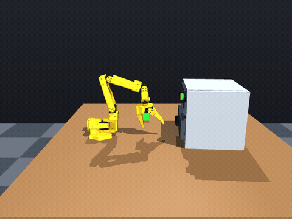
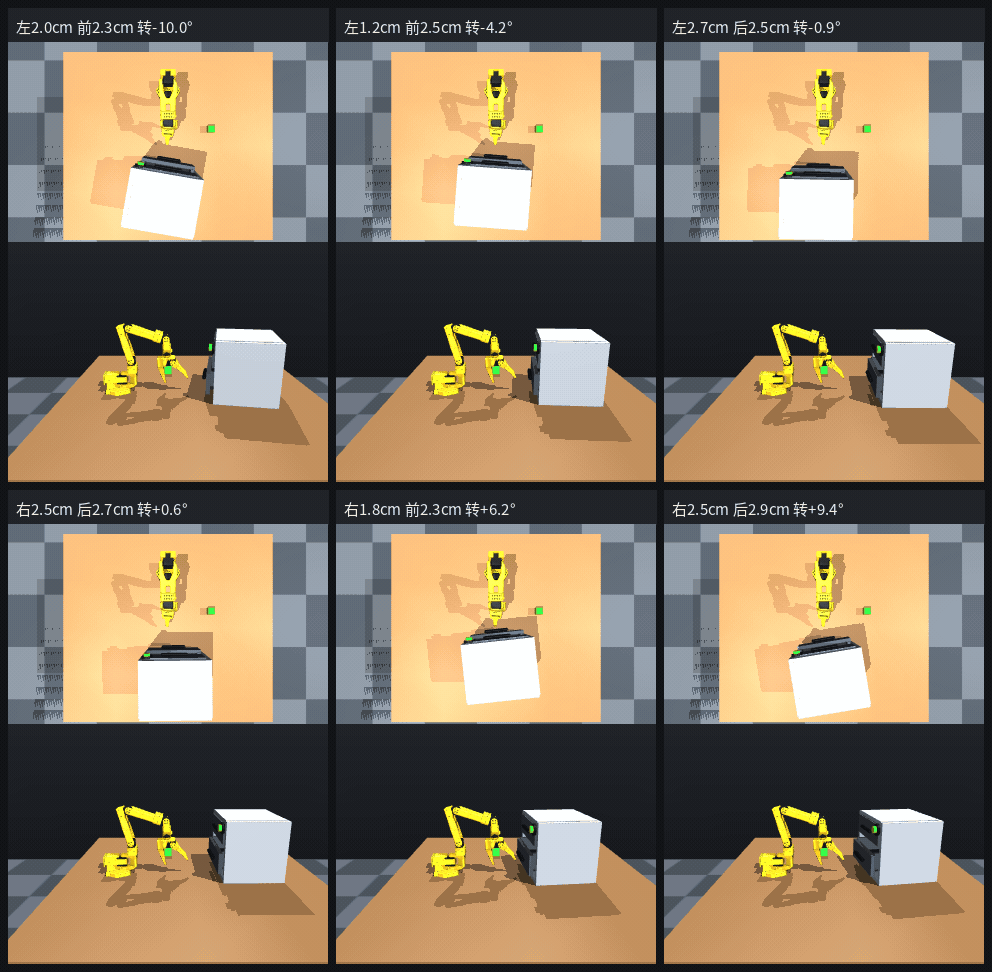
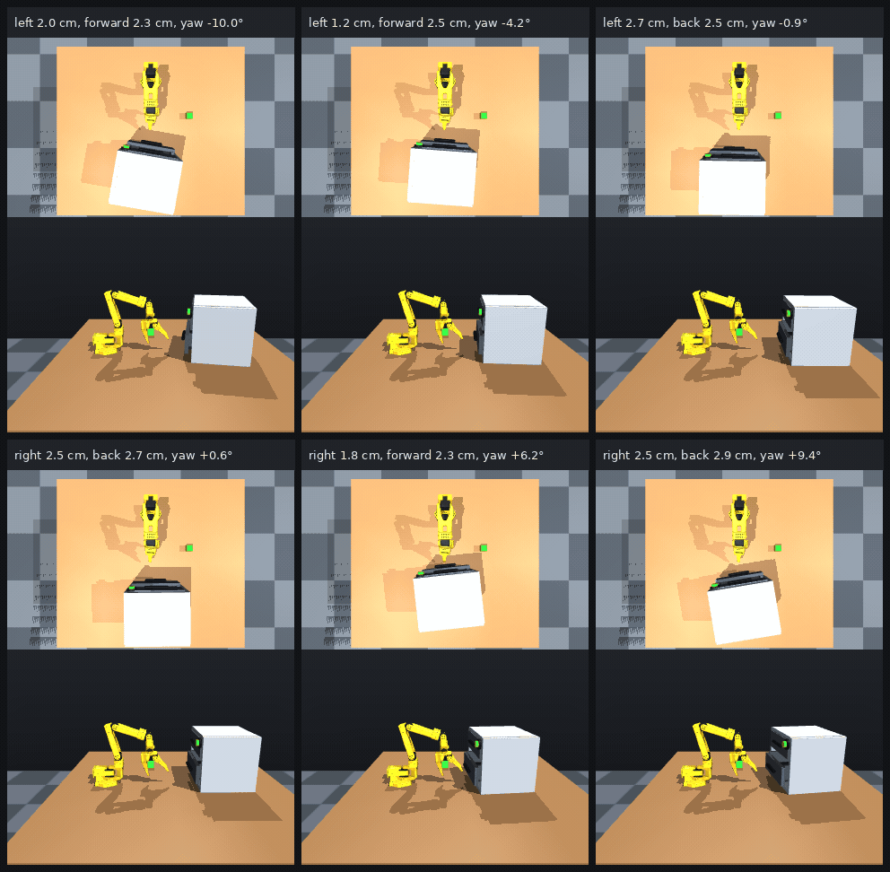

# RAX drawer prototype

This lab adds a task-level environment and RAX-style robot backend for opening the existing SO-101 `smart_drawer` MuJoCo scene. It leaves the LeRobot recording and policy-training workflows unchanged.

**Strict RAX place session:** `rax_place/` — tool-only explore → compile → locked test. Process log: [`rax_place/PROCESS.md`](rax_place/PROCESS.md). Freeze 3 scored **15 / 20** on the locked place task.

## Task and success contract

- Goal (open/close): grasp the lower drawer handle and pull toward the SO-101, then return it.
- Goal (place, optional): after opening, put the green cube in the drawer tray, then close. Enable with `DrawerTaskConfig.require_cube_placed=True`.
- Drawer joint: `drawer_slide`, physical range 0–0.08 m. The green button is decorative; there is no lock behavior.
- Success (open/close): open at least 0.06 m farther than the drawer's settled position at episode reset, with handle contact on the pull and on the return to within 5 mm of that start.
- Success (place): the open/close criteria plus the cube resting in the tray (evaluator AABB; the controller does not receive cube or drawer poses as control).
- Valid initial openings are 0–0.02 m, leaving enough travel.
- Seed is metadata because this scene is deterministic; `drawer_position_m` selects the initial drawer opening.
- Each velocity component is bounded by the configured speed limits; a tool call lasts no longer than 2 s.

## How the implementation works

### Environment (`environment.py`)

`RaxDrawerEnv` wraps the existing `SO101MujocoRobot` and the scene `SO101/scenes/smart_drawer/scene.xml`.

1. It configures velocity control and the control cameras: overhead `top` (Gemini 336L depth, 1280×800), `side` (color, 640×480), and gripper `wrist`. Observations given to a controller are joint state, camera calibration, color frames, and overhead depth. Drawer-joint position is used only to score the episode.
2. `reset()` sends the arm to its home pose, resets the scene block, puts the drawer at the requested opening, clears its velocity, advances the simulation briefly to settle, and then records that settled position as the episode baseline.
3. `observe()` returns joint positions and velocities, camera calibration, color frames for `top`, `side`, and `wrist`, and overhead depth in millimeters. It does not return the drawer joint or the handle pose.
4. `step()` clamps world-frame velocity and gripper/wrist actions, advances a bounded duration through the existing robot controller, and returns a fresh observation plus termination state.
5. `check_success()` is the episode score: lower-handle contact while pulling, at least 6 cm of opening, then a return to within 5 mm of this episode's start. The controller does not receive the drawer position used for that score.

The supported action fields are `vx`, `vy`, `vz` in m/s, `wrist_flex_rate` and `yaw_rate` in rad/s, and `gripper_delta` in the SO101 velocity controller's rate convention. Positive Y pulls the drawer toward the robot; negative `gripper_delta` closes the gripper.

### RAX backend (`backend.py`)

`RaxDrawerBackend` implements the `real/franka` robot-service shape expected by the RAX runtime: `tools()`, `call()`, `status()`, and `close()`. It exposes four calls:

- `drawer_reset`: start a fresh episode.
- `drawer_observe`: return state and camera images.
- `drawer_step`: apply one bounded action and return the updated state.
- `drawer_check_success`: report whether the episode goal is met.

RGB arrays are encoded as PNG MCP image blocks so an image-capable agent can inspect the scene. The backend adapts the existing simulator; it does not alter the MuJoCo scene format or train a policy.

### Runtime and demonstration

The positive-control sequence in `smoke.py` and `live_gui.py` is a deterministic scripted demonstration: wrist adjustment, approach, close, then short positive-Y pulls with feedback checks. It validates reachability and the task contract. It is **not** an autonomous RAX/LLM policy rollout.

For RAX integration, register the backend in a runtime branch that contains `services/backends.py`:

```python
BACKENDS["so101_drawer"] = "labs.rax_drawer.backend:RaxDrawerBackend"
```

Put both the RAX runtime root and this repository root on `PYTHONPATH`, and configure the service to use this repository's `.venv-rocm/bin/python`. Start a session with `robot="so101_drawer"` and this directory's `TASK.md` as its task description. Optional backend settings include `scene_path`, `camera_names`, `success_position_m`, `episode_limit_s`, and action limits.

On Halo the detached `real/franka` checkout is `~/Repo/RAX/rax-drawer-runtime`, and its `services/backends.py` registers `so101_drawer`. Headless rendering uses `MUJOCO_GL=osmesa`. A controller that opened the drawer by servoing to a fixed world Y is withdrawn: it used the drawer joint and a measured coordinate, so it is not a valid RAX generalization policy.

`open_close.py` is the non-privileged program for open/close. It finds the lower handle from the overhead color and depth, pulls along that bar's horizontal normal toward the fixed arm mount, then pushes back to the grasp point. It does not read the drawer joint. Develop against `manifests/explore.json`. The locked held-out file `manifests/test.json` is only for the final score. On 2026-10-29 that program succeeded on **16 of 20** test scenes (0 unreachable). The same program succeeded on 37 of 50 explore scenes; that explore number is not the reported rate.

The reported place program is `rax_place/code/open_place_close/`. It uses only `reset`, `observe`, `step`, and `check_success`. Overhead color and depth find the lower handle and the green cube. The arm opens the drawer with velocity control, picks the cube with joint-position Jacobian control, drops it 5.5 cm inside the perceived handle, then closes by servoing onto that same pull axis. Drawer joint, handle pose, cube pose, and contacts stay in the evaluator. SmolVLA and pi0.5 were not used: there are no drawer-open/place demos, and their camera and action layouts do not match this scene.

Freeze 3 (`20261031T093325Z`) scored **15 of 20** on `manifests/test.json`. Before that freeze, explore scenes 0–23 scored 18/24 and held-out explore scenes 24–43 scored 13/20. Replay the locked run with `./labs/rax_drawer/rax_place/eval_locked.cmd`. The process log is [`rax_place/PROCESS.md`](rax_place/PROCESS.md). This place rate is separate from the 16/20 open/close figure.

`place_close.py` is an earlier direct-environment variant of the same perception. It is not the reported 15/20 program.

The side-camera clip below is explore scene 0 (cabinet shifted −1.2 cm / +2.5 cm and yawed −4.2°). That run finished 0.46 cm from the start with handle contact on both the pull and the return.



The 3×2 clip runs the same program on six explore layouts, from −10° to +9.4° and shifts of about 2–3 cm. Each cell is the overhead view above the side view. All six finished within 0.5 cm of that episode's start.



The same clip with English captions is `media/open_close_grid_en.gif`.



## Setup

On the target Linux host, use the repository's normal setup (including submodules and `make rocm-sync`). The tested environment on halo used Python 3.12, Torch `2.14.1+rocm7.2`, and MuJoCo `3.16.0`.

From the repository root on halo:

```bash
cd ~/Repo/RAX/so101-simstudio
.venv-rocm/bin/python -m labs.rax_drawer.smoke
```

The smoke checks scene loading, the RAX tool contract, drawer sensor reads, reset from a displaced/moving drawer, episode-relative scoring, action bounds, PNG packing, and a no-op action.

### Reproduce the checks

```bash
# Render and package top/side/wrist frames plus top depth (headless EGL)
MUJOCO_GL=egl .venv-rocm/bin/python -m labs.rax_drawer.smoke --with-cameras

# Positive-control pull at 0, 1, and 2 cm initial drawer openings
.venv-rocm/bin/python -m labs.rax_drawer.smoke --pull-demo

# Interactive three-camera GUI replay; run from the active desktop session
DISPLAY=:0 .venv-rocm/bin/python -m labs.rax_drawer.live_gui
```

`live_gui` opens the scene cameras in the SO101 MuJoCo camera grid. The control views are overhead `top` and `wrist`; `front` and `overview` stay available for viewing. It runs the same bounded positive-control pull, then leaves the completed state visible until the window is closed. If started from SSH rather than a desktop terminal, use the active session's `DISPLAY` and `XAUTHORITY` values so the window is shown on the logged-in desktop. The camera smoke uses EGL; the live window uses GLFW.

## Verified result

On halo, the feedback-driven pull smoke reached the 6 cm success threshold from all three tested starts:

| Initial opening | Final additional opening | Pull chunks |
| ---: | ---: | ---: |
| 0 cm | 6.03 cm | 6 |
| 1 cm | 6.10 cm | 6 |
| 2 cm | 6.02 cm | 8 |

The three-camera live GUI replay also completed successfully at about 6.05 cm opening. These figures validate this simulator scene and scripted positive control; they do not measure an autonomous policy's success rate.

## Files

- `environment.py`: task environment and episode contract (optional `require_cube_placed`).
- `backend.py`: RAX robot-service adapter and PNG camera responses.
- `open_close.py`: non-privileged open/close program (reported 16/20 test).
- `place_close.py`: earlier direct-environment place variant. The reported 15/20 program is `rax_place/`.
- `rax_place/`: tool-only session, frozen controller, explore and locked-test scripts. Replay with `rax_place/eval_locked.cmd`.
- `smoke.py`: contract checks and optional feedback-driven positive control.
- `live_gui.py`: Lab01-style three-camera live demonstration.
- `TASK.md`: concise task instructions suitable for an agent session.