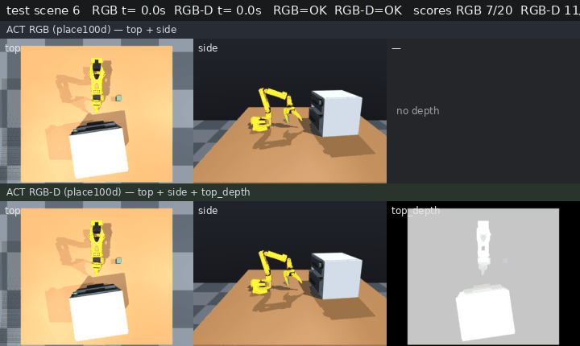

# ACT RGB vs RGB-D depth ablation (RAX drawer place)

Same demos (`place100d`), same ACT recipe (30k steps, batch 64 on MI300X / local ROCm), closed-loop eval on halo with locked manifests. Depth is overhead `camera_top_depth`: metric top depth rendered as **3-channel gray** so ACT/ResNet can consume it next to RGB.

Compare montage (test scene 6; both OK; wrist omitted):



## Hub assets

| Asset | Hugging Face path |
|-------|-------------------|
| Dataset (place100d) | [`alexhegit/so101-simstudio-rax-drawer-place100d`](https://huggingface.co/datasets/alexhegit/so101-simstudio-rax-drawer-place100d) |
| ACT RGB (no depth) | [`alexhegit/so101-simstudio-rax-drawer-act-rgb-place100d`](https://huggingface.co/alexhegit/so101-simstudio-rax-drawer-act-rgb-place100d) |
| ACT RGB-D (+ top depth) | [`alexhegit/so101-simstudio-rax-drawer-act-rgbd-place100d`](https://huggingface.co/alexhegit/so101-simstudio-rax-drawer-act-rgbd-place100d) |

Local mirrors (halo):

- Dataset: `datasets/so101-simstudio-rax-drawer-place100d`
- RGB ckpt: `outputs/train/rax_drawer_act_rgb/checkpoints/030000/pretrained_model`
- RGB-D ckpt: `outputs/train/rax_drawer_act_rgbd/checkpoints/030000/pretrained_model`

## Closed-loop results

This section is the **canonical comparison table** for the practice (also mirrored on the
[ACT RGB-D model card](https://huggingface.co/alexhegit/so101-simstudio-rax-drawer-act-rgbd-place100d)).

Protocol: `labs/rax_drawer/vla/eval_policy.py`, state 6-D joint `.pos`, explore10 + test20, `MUJOCO_GL=egl` on halo.

| Policy | explore10 | test20 | Δ vs place100d RGB |
|--------|-----------|--------|--------------------|
| place100d **RGB** | 4/10 (40%) | 7/20 (35%) | — |
| place100d **RGB-D** | **6/10 (60%)** | **11/20 (55%)** | **+20 pp / +20 pp** |
| prior place100b RGB (reference) | 5/10 (50%) | 9/20 (45%) | — |

Machine-readable: [`results/rgb_vs_rgbd_summary.json`](results/rgb_vs_rgbd_summary.json) (+ per-split JSON next to it).

**Takeaway:** with matched data and training budget, top-depth gray lifts ACT by **+20 pp** on both splits vs place100d RGB, and slightly above the older place100b RGB baseline. Caveats: n is small; depth is gray pseudo-RGB (not a dedicated depth backbone); place100d RGB alone is a bit weaker than the older RGB set.

## Reproduce

```bash
# Collect (already done for the Hub dataset)
MUJOCO_GL=egl RAX_TARGET=100 ./labs/rax_drawer/collect_rax_place.cmd

# Train
./labs/rax_drawer/vla/train_act_rgb.cmd    # drops camera_top_depth
./labs/rax_drawer/vla/train_act_rgbd.cmd   # keeps depth

# Eval
MUJOCO_GL=egl .venv-rocm/bin/python -m labs.rax_drawer.vla.eval_policy \
  --policy ./outputs/train/rax_drawer_act_rgb/checkpoints/030000/pretrained_model \
  --episodes 20 --split test \
  --out outputs/eval/rax_drawer_act_rgb_place100d_test20.json

MUJOCO_GL=egl .venv-rocm/bin/python -m labs.rax_drawer.vla.eval_policy \
  --policy ./outputs/train/rax_drawer_act_rgbd/checkpoints/030000/pretrained_model \
  --episodes 20 --split test \
  --out outputs/eval/rax_drawer_act_rgbd_place100d_test20.json

# Compare GIF (top + side + depth column; no wrist)
MUJOCO_GL=egl .venv-rocm/bin/python -m labs.rax_drawer.vla.render_policy_compare_gif \
  --scene 6 --out labs/rax_drawer/media/act_rgb_vs_rgbd_compare.gif
```

Push helpers (run on **DORobot** against official `https://huggingface.co`, not hf-mirror):
`./labs/rax_drawer/vla/push_act_models.cmd`, `./labs/rax_drawer/vla/push_place100d_dataset.cmd`.
